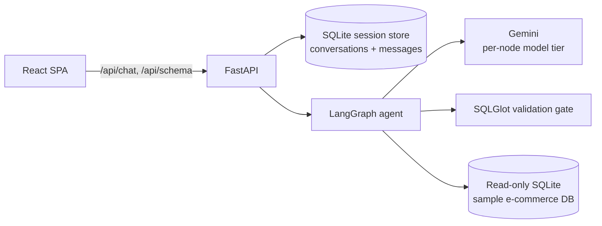
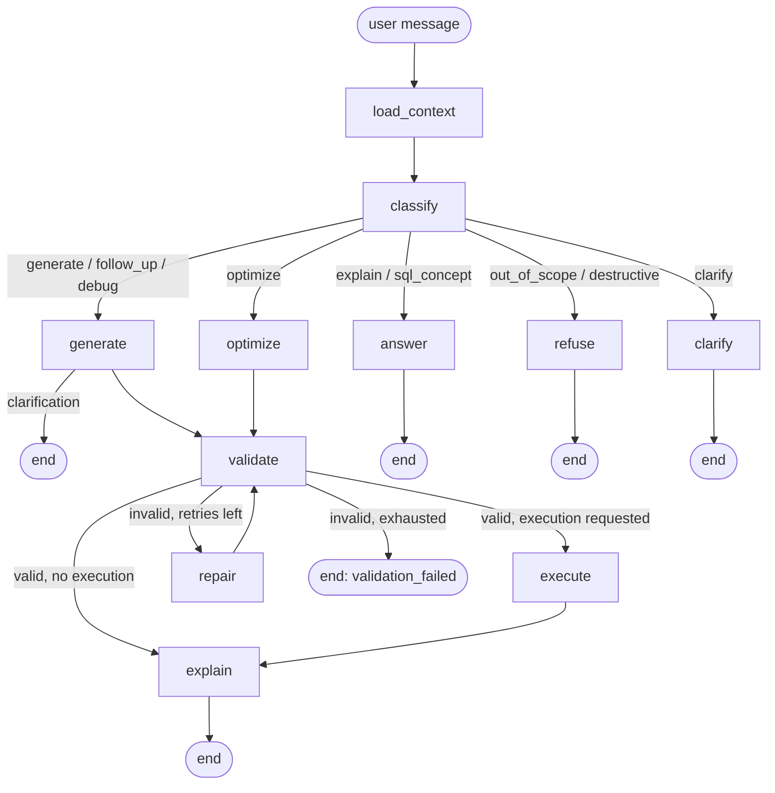

# Architecture

SQL Agent turns natural language into **validated, read-only SQL** against a known e-commerce
schema, explains it, and can execute it safely. The guiding rule is **the LLM proposes; code
decides** — no SQL is ever returned or executed unless a deterministic validator and a
read-only database layer both approve it.

## High-level

- One FastAPI service exposes the API and (in the container image) serves the built SPA, so
  there is a single origin and no CORS surface.
- The **sample database** (what queries run against) is strictly separate from the **app
  database** (conversations/messages). The agent only ever touches the sample DB read-only.

## The agent graph (LangGraph `StateGraph`)

| Node | LLM? | Model tier | Responsibility |
|---|---|---|---|
| `load_context` | no | — | Inject authorized schema summary + last validated SQL (for follow-ups) |
| `classify` | yes | Flash-Lite | Intent + confidence (structured output) |
| `generate` | yes | Flash | NL → candidate SQL (also debug/follow-up); returns a clarification if ambiguous |
| `optimize` | yes | Flash | Rewrite pasted SQL to an equivalent, cleaner form |
| `validate` | no | — | **The gate** (see below). Pure code |
| `repair` | yes | Flash | Fix invalid SQL from structured validator issues; bounded to 2 attempts |
| `execute` | no | — | Run validated SQL through the read-only sandbox |
| `explain` | yes | Flash-Lite | Plain-English explanation of the final SQL (never sees result rows) |
| `answer` | yes | Flash-Lite | Prose answer for SQL concept / explain-a-query intents |
| `refuse` / `clarify` | no | — | Deterministic refusal / clarification terminal states |

**Why a graph, not one prompt:** explicit, testable routing; a hard code gate between
"model proposed" and "user receives"; bounded repair loops; and per-node telemetry
(tokens, latency, model) accumulated in the state for traceability.

## The validation gate (deterministic, no LLM)

Runs after every generation/repair/optimization, cheapest and most decisive checks first:

1. **Parse** with SQLGlot (configured dialect); reject parse errors.
2. **Single statement** — reject multi-statement and comment-hidden statements.
3. **Read-only root + AST walk** — root must be `SELECT`/`WITH`/`UNION`; reject any
   DML/DDL/`PRAGMA`/`ATTACH`/`SELECT … INTO` anywhere (including nested CTEs).
4. **Function allowlist** — deny-by-default; dangerous functions (`load_extension`, …) blocked.
5. **Schema binding** — resolve tables/columns against the authorized catalog; unknown or
   ambiguous references become structured errors.
6. **Join checks** — cartesian products are errors; non-FK joins and aggregate fan-out are warnings.
7. **Real-engine `EXPLAIN`** — the final arbiter of syntax/columns.

Structured issue codes (`UNKNOWN_TABLE`, `FORBIDDEN_OPERATION`, …) feed the `repair` node.

## Defense in depth (security)

- **Prompt injection:** user text is treated as data, never instructions. Result rows and raw
  DB contents never go back to the LLM. The code gate and DB layer sit *after* the model, so a
  fully fooled model still can't cause harm.
- **Read-only database layer** (independent of the validator): the sample DB is opened
  `mode=ro`, `PRAGMA query_only=ON`, with a SQLite **authorizer** that allows only SELECT/READ
  and allowlisted functions, plus a progress-handler timeout and a row cap.
- **Execution eligibility** is a server-issued result bound to the exact validated SQL — the
  frontend can never assert `validated=true`.
- **Output safety:** explanations render as sanitized markdown; CSV export escapes
  formula-injection (`= + - @`). Generic client errors; structured per-request logs with a
  `trace_id`; secrets only in env vars.

## Trust boundaries

User text, model output, and database *contents* are untrusted. The **schema catalog** is
server-owned and authoritative. The LLM never receives DB credentials and never executes SQL —
execution is optional and flows only through the validated, restricted adapter.

## Conversation memory

A SQLite session store persists conversations and messages and returns the last **validated**
SQL for a thread, which grounds follow-up requests (e.g. "only California") without re-starting.

## Tech stack

Python 3.12 · FastAPI · LangGraph · SQLGlot · SQLite · `langchain-google-genai` (Gemini) ·
React + TypeScript + Vite + Tailwind. Quality: pytest, ruff, mypy (strict), GitHub Actions, Docker.
